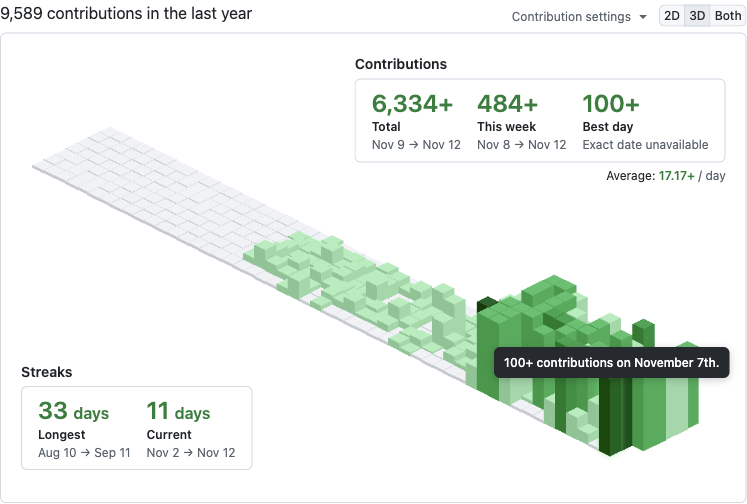
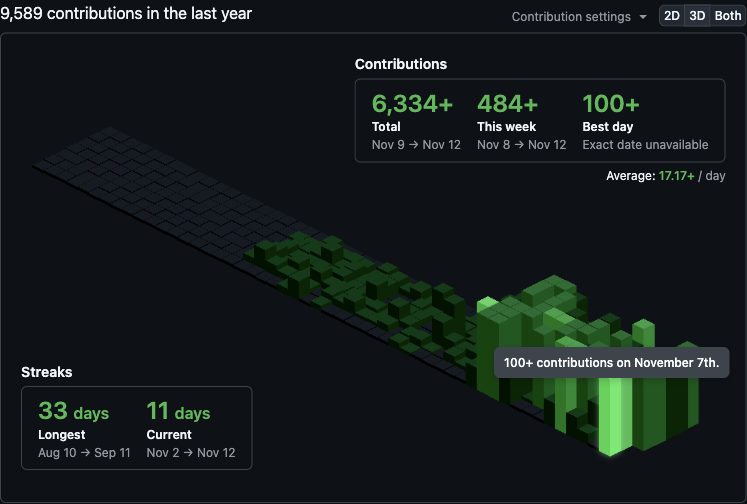

# Isometric Contributions extension

This is a browser extension for Chrome/Brave and Firefox that lets you toggle between your regular GitHub contribution chart and an isometric pixel art version. It uses [obelisk.js](https://github.com/nosir/obelisk.js) for the isometric graphics.

The isometric view highlights differences in daily contributions. Hover over a visible bar to give it a subtle glow and see the same date and contribution count as GitHub's 2D tooltip. Shorter bars can still be hidden behind taller ones.

Heights are scaled linearly against the largest visible daily count. When GitHub reports a capped count such as `100+`, the chart uses 100 as a lower bound and keeps `100+` in the tooltip. Totals and averages calculated from capped counts are also marked with `+`; the exact best day cannot be determined from these counts. Contributions follow GitHub's calendar and include more than commits.

## Installation

### Chrome/Brave

[Install from the Chrome Web Store](https://chrome.google.com/webstore/detail/isometric-contributions/mjoedlfflcchnleknnceiplgaeoegien?hl=en&gl=US)

### Firefox

[Install from Mozilla Add-ons site](https://addons.mozilla.org/en-US/firefox/addon/github-isometric-contributions/)

### Microsoft Edge

[Install from Microsoft Edge Add-ons site](https://microsoftedge.microsoft.com/addons/detail/github-isometric-contribu/hcicbpfcbdpfgibhlbphodkcbojakpej)

## Contributing

**_Note that I don't currently have any plans for adding new features to the extension. Please contact me before submitting a PR with new functionality._**

If you want to hack on the extension, you'll need to install it manually. First clone or fork this repo. Then, on your Chrome Extensions page, make sure "Developer mode" is checked. You can then click the "Load unpacked extension..." button and browse to the `src` directory of this repo.

To hack on the extension, you'll first need to make sure you've installed it in Developer mode (see above). Once you've made changes to the extension, go back to the Extensions page and click the Reload link under the extension entry.

## Community Forks

- [isometric-contributions-plus](https://github.com/Qiuner/isometric-contributions-plus) - Extended version with GitCode integration and additional features

## License

This project is licensed under the [MIT License](http://opensource.org/licenses/MIT).
